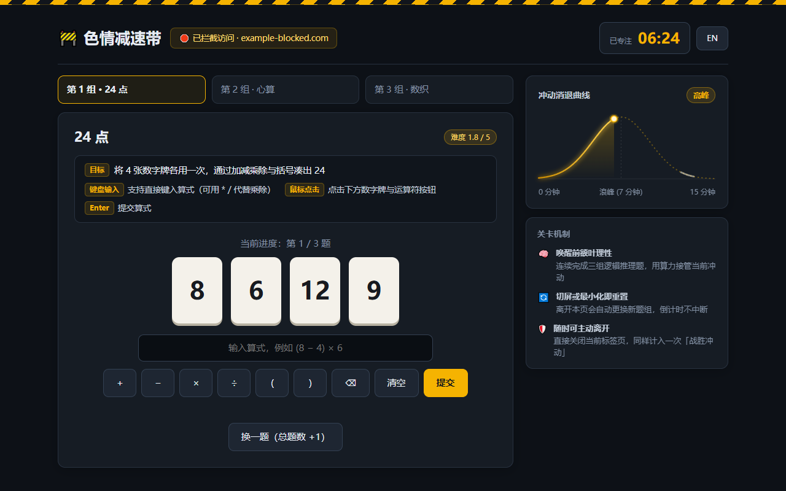
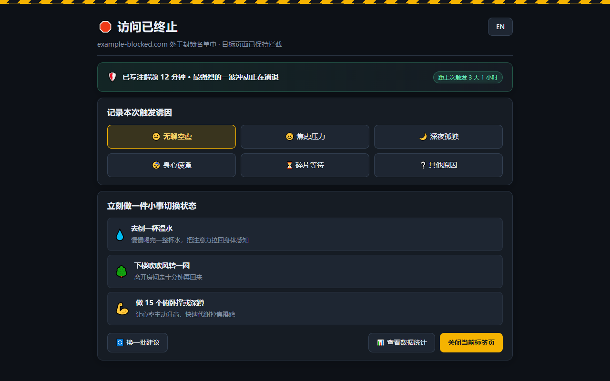
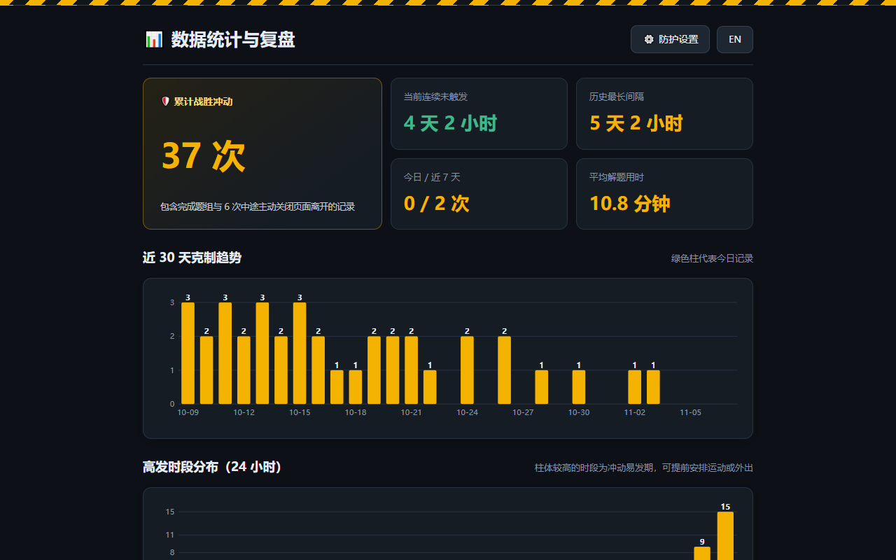
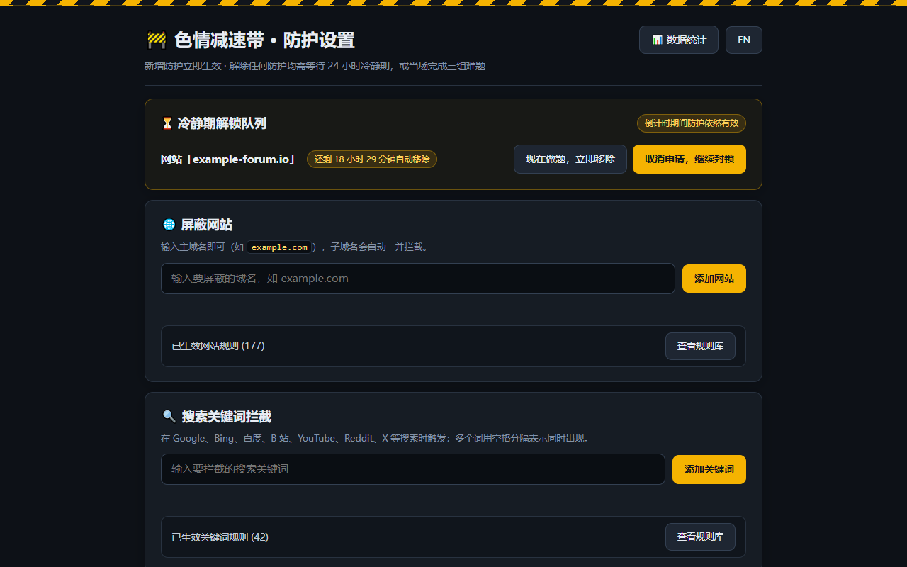

  
  <h1>🚧 JAV Speed Bump</h1>
  
<b>"Lock a door, and an impulsive mind will only look for a crowbar. Build ten speed bumps in front of it, and you'll come to your senses before you reach the handle."</b>

  

    
    
    
    
    
  

  
<b><a href="README.md">简体中文</a> · <a href="README.en.md">English</a></b>

---

`JAV Speed Bump` is a Chrome / Edge extension built on **Friction Cost** and **Relapse Prevention** psychology (with full English & Chinese UI support). Whenever you try to open an adult website, search for sensitive keywords, or re-download the Steam client on impulse to play adult games, it intercepts the navigation and brings you to a **Logic Puzzle Gate**.

To get through, you need to spend about 10 minutes solving three randomly generated math and logic puzzles in a row (6×6 Sudoku, Nonogram, Make 24, and Mental Math). This focused cognitive workout wakes up your dormant prefrontal cortex and helps you ride out the 15-minute physiological urge wave.

---

## Why I Built This

Before building this extension, I tried almost every conventional method to quit porn. I modified my system `hosts` file, configured Clash proxy blocking rules, and set up browser-level site blockers.

Anyone who has tried those tools knows the truth: **a static wall is never enough.**

Because you built the wall yourself, you also hold the key. When your mind is clear during the day, everything is fine. But late at night, or when you're stressed, lonely, or bored, an urge hits—and it takes less than thirty seconds to undo your own config, disable the blocker, or open an incognito window. Against a spike of dopamine craving, brute-force prohibition only triggers rebellion.

So I stopped and asked myself: *When in my life did I actually succeed in breaking a bad habit without feeling miserable?* Two small real-life experiences came to mind.

**The first was deleting my desktop shortcut for QQ (a messaging app).**
There was a period when I constantly opened QQ out of habit to chat aimlessly, wasting hours every week. I didn't swear a solemn oath to quit. I simply deleted the QQ shortcut from my desktop and taskbar. Without the icon staring at me, opening the app meant digging through nested folders on my hard drive every single time. Because the action became annoying and high-friction, I naturally stopped opening it on impulse.

**The second was my ex-girlfriend, dancing videos, and Minesweeper.**
My ex-girlfriend hated that I used to scroll through short videos of dancing girls on Bilibili. When I looked closely at my own behavior, I realized I wasn't even seeking them out intentionally—it almost always happened during tiny fragments of **"waiting time"** at work (waiting for code to compile, waiting for a file to load, or waiting for a reply). The moment my brain had nothing to do for two minutes, my thumb went on autopilot.
So I installed a Minesweeper app on my phone. Whenever I hit a waiting gap, I immediately opened Minesweeper and played a quick board. It required just enough logic to engage my brain without feeling stressful. The whole transition was surprisingly comfortable: I sharpened my mind and effortlessly dropped the habit of scrolling dancing videos.

Putting those two experiences together, everything clicked: humans have struggled with impulses for thousands of years, and the solution has never been brute willpower. What actually works is **raising the friction cost of the habit** while **handing your brain a moderately engaging logical task during moments of vulnerability**.

---

## Why "Cold Turkey Oaths" Fail, and Speed Bumps Work

People often treat quitting an addiction as an all-or-nothing war—as if making a vow today means never slipping up again tomorrow. The moment a relapse happens, shame sets in ("I failed anyway, might as well binge"), and the whole effort collapses.

**In reality, overcoming an addiction is never an overnight miracle. It is a gradual process of stretching out the intervals between relapses and lowering their frequency.**

Just as a heavy smoker rarely drops from 20 cigarettes a day to zero overnight—but can step down from 20 to 15, then to 10, and eventually quit—breaking a porn habit follows the same curve. Maybe your first streak lasts 4 days before you slip. Then your next streak lasts 6 days, then 10 days, then three weeks.

Along that curve, you don't need superhuman willpower. `JAV Speed Bump` is designed around four proven principles from behavioral psychology and neuroscience:

### 1. Friction Cost: Put Sand in the Gears of Autopilot Habits
Behavioral economics and habit research by psychologist Wendy Wood show that over 40% of daily habits are **automatic responses** triggered by context (boredom, stress, fatigue, or waiting).
Adding a site to `JAV Speed Bump` takes one second. **Removing a site—or turning off Steam protection—requires either waiting through a 24-hour cooldown or solving three high-difficulty puzzle stages on the spot.** When the cost of acting on an impulse becomes high enough, your brain simply decides it isn't worth the trouble.

### 2. Prefrontal Cortex Activation: Crowd Out Dopamine Cravings with Logic
When an urge spikes, your brain's **limbic system** hijacks your attention while suppressing the **prefrontal cortex** (the seat of rational self-control).
Our four puzzle types—**6×6 Sudoku, Nonogram, Make 24, and Mental Math**—are calibrated to sit right in the cognitive sweet spot: you can't bluff through them by memory, yet they are always logically solvable. As soon as you start calculating numbers and deducing grid cells, blood flow shifts back to your prefrontal cortex, cooling down the physiological craving within minutes.

### 3. Urge Surfing: Ride Out the 15-Minute Wave
Addiction researcher Alan Marlatt pioneered **Urge Surfing**: a craving is like an ocean wave that crests and naturally subsides within **10 to 15 minutes** if you don't feed it.
The live **Urge Wave Curve** on the right side of the puzzle gate shows you visually where you are on that 15-minute curve. If you switch tabs or minimize the window mid-puzzle, the current puzzle set resets immediately (while the timer keeps running), preventing you from bypassing the focus period.

### 4. Avoiding the Abstinence Violation Effect: Every Pause Counts as a Win
Most streak-tracking apps punish a single slip by resetting your counter to zero—triggering shame and a full relapse (the **Abstinence Violation Effect**).
`JAV Speed Bump` never counts "failures." Its headline metric is **Urges Overcome**. Every time the speed bump catches you—even if you close the tab halfway through a puzzle and walk away—it counts as a victory.

---

## Three Core Lines of Defense

### 🛡️ 1. 160+ Built-in Adult Domains & Dedicated TLDs
* **Curated Blocklist (Collapsed by Default)**: Ships with 160+ high-risk adult domains (automatically covering all subdomains) and dedicated adult top-level domains. In the Settings page, the built-in list is **collapsed by default** so you never see triggering domain names unless you explicitly click to inspect or search them.
* **Zero-Flash Pre-Request Interception**: Powered by Chrome MV3 `declarativeNetRequest`, redirecting before a single pixel of the target site can load.

### 🔍 2. Search Engine & Video Platform Keyword Interception
* **Multilingual Keyword Filter**: Intercepts sensitive search queries across **Google, Bing, Baidu, DuckDuckGo, Yandex, Yahoo, Bilibili, YouTube, Reddit, and X (Twitter)**.
* **Smart Whole-Word Matching**: ASCII keywords match on strict word boundaries so technical or everyday searches are never falsely flagged.

### 🎮 3. Tiered Steam Protection (Prevent Re-installing Adult Games)
An independent module built specifically for users quitting adult games on Steam (off by default, configurable in Settings with two tiers):
* **🟡 Light Mode · Block Client Download Only (Anti-Reinstall)**:
  * **Why it exists**: Many users uninstall the Steam client in a moment of resolve to quit adult games, only to relapse late at night and re-download the installer. Yet blocking all of Steam would prevent browsing normal games or community guides.
  * **Surgical Interception**: Searching for `steam` and browsing normal Steam store pages or community forums work normally. However, the moment you click into the **Steam Client Download page (`/about`)** or trigger a **direct client installer download (`SteamSetup.exe`, `steam.dmg`, etc.)**, the puzzle speed bump intercepts it immediately.
* **🔴 Strict Mode · Block Entire Steam**:
  * Blocks all Steam store pages, community pages, installer CDNs, and Steam search queries across search engines.
* **One-Step Cooldown to Disable**: Enabling or upgrading protection is instant. Turning Steam protection off from either mode requires a **24-hour cooldown** or **solving 3 high-difficulty puzzle stages**, after which it resets directly to Off in one step.

---

## Screenshots

| Puzzle Gate (Sudoku / Nonogram / Make 24 / Mental Math + Urge Curve) | Endpoint Page (Trigger Attribution + State-Switch Ideas) |
| :---: | :---: |
|  |  |
| **Statistics & Peak Urge Hour Review** | **Settings (Tiered Steam Protection + Embedded Lock Tool)** |
|  |  |

---

## Installation & Anti-Uninstall Lock

### 1. One-Click Install from Chrome Web Store
Install directly from the official Chrome Web Store (works on Chrome, Edge, and other Chromium browsers):
👉 **[Install JAV Speed Bump on Chrome Web Store](https://chromewebstore.google.com/detail/%E8%89%B2%E6%83%85%E5%87%8F%E9%80%9F%E5%B8%A6-jav-speed-bump/jlojhodaahihefilcenmaiopkkjkekmb)**

*(Tip: To keep protection active in Incognito windows, open `chrome://extensions`, click Details on JAV Speed Bump, and enable "Allow in Incognito".)*

### 2. Anti-Uninstall Lock for Windows & macOS (Embedded in Settings)
To prevent yourself from impulsively disabling or removing the extension when an urge hits, an **Anti-Uninstall Lock** card is built directly into the extension's Settings page. Clicking **"📥 Download Lock Tool"** automatically downloads the right lock file for your OS (and you can switch tabs in the card to view steps for either platform):

* **🪟 Windows**:
  1. Click **"📥 Download Lock Tool"** in the extension Settings page.
  2. Click **"Open"** on the downloaded file in your browser's top-right download bar, then click **"Run" → "Yes"** (Note: the locally generated script has no paid commercial certificate, so the "Unknown Publisher" prompt is normal).
  3. Restart your browser—the "Disable" and "Remove" buttons on the extensions page will be locked and grayed out.
  4. **How to Unlock Anytime**: Open Windows **Settings → Apps → Installed apps**, search for `JAV Speed Bump Policy Lock`, click Uninstall, and restart your browser.
* **🍎 macOS**:
  1. Click **"📥 Download Lock Tool"** in the extension Settings page.
  2. Click **"Open"** in your browser's downloads, then open macOS **System Settings → General → Device Management**, double-click `JAV Speed Bump Policy Lock`, and click **Install**.
  3. Quit and reopen your browser (`Cmd + Q`)—the "Disable" and "Remove" buttons on the extensions page will be locked and grayed out.
  4. **How to Unlock Anytime**: Open macOS **System Settings → General → Device Management**, select `JAV Speed Bump Policy Lock`, click **`-` (Remove)**, and restart your browser.

---

## Privacy Guarantee

* **100% Local Storage**: All blocklists, Steam protection settings, and trigger logs are stored strictly on your own device in `chrome.storage.local`. The extension makes zero external network requests and collects no telemetry. See [PRIVACY.md](PRIVACY.md) for details.

---

## 📦 Developer Build Notes

Running `npm run build` outputs two `.zip` archives under `dist/` (identical source code, different directory nesting):

* **`dist/jav-speed-bump-store.zip` (For Chrome Web Store Upload Only)**: Places `manifest.json` directly at the root of the archive as strictly required by the Chrome Web Store Developer Dashboard. **Always upload the `-store.zip` package when publishing to the Chrome Web Store.**
* **`dist/jav-speed-bump.zip` (For GitHub Release / Manual Unzip)**: Wraps all files inside a top-level `jav-speed-bump/` folder so manual extraction stays tidy and can be loaded directly via `chrome://extensions` → "Load unpacked".

## License

[MIT](LICENSE)
