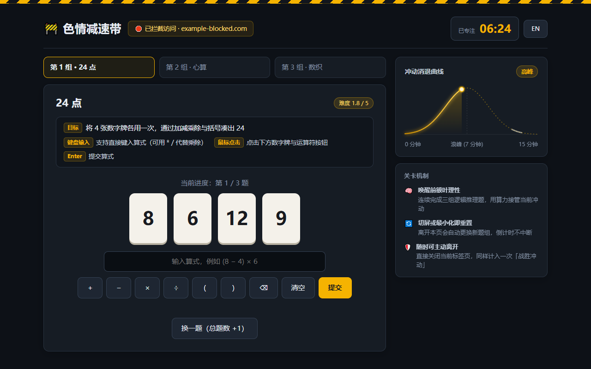
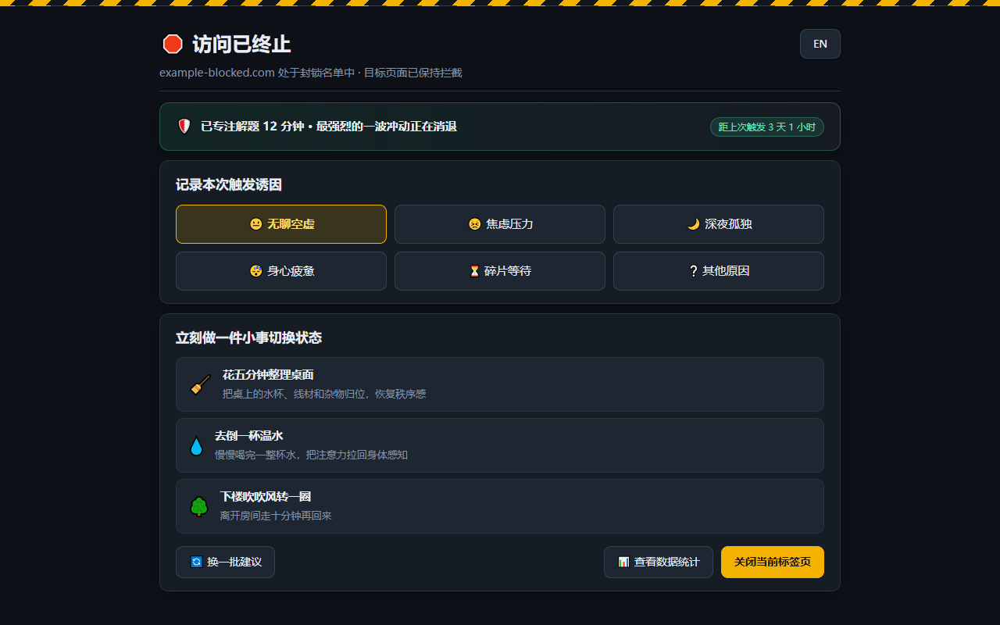
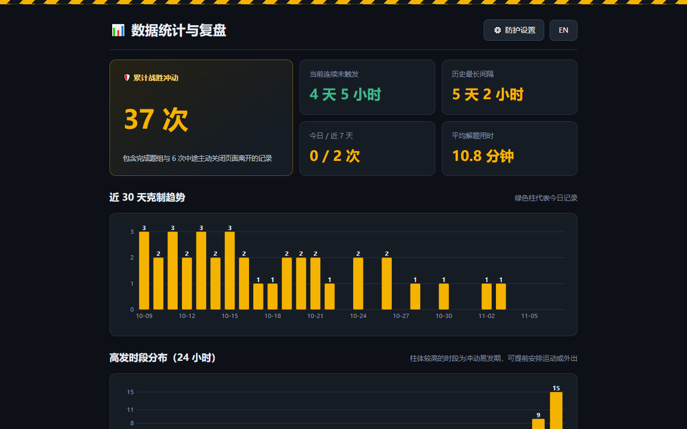
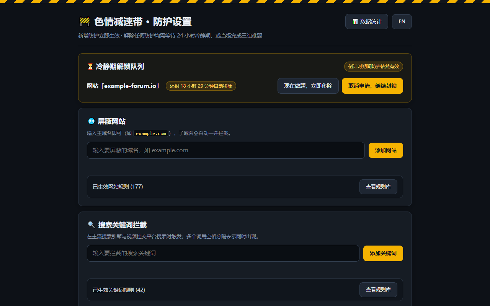

  
  <h1>🚧 色情减速带 · JAV Speed Bump</h1>
  
<b>「堵死一扇门，上头时你只会想办法撬锁；如果在门前修十道减速带，你走着走着就清醒了。」</b>

  

    
    
    
    
    
  

  
<b><a href="README.md">简体中文</a> · <a href="README.en.md">English</a></b>

---

`JAV Speed Bump` 是一款基于「摩擦成本」与「成瘾防复发机制」设计的 Chrome / Edge 浏览器扩展（支持中英双语切换）。当你试图打开成人网站、搜索敏感词、或是冲动之下想重新下载安装 Steam 客户端玩成人游戏（黄油）时，它会先将页面拦截到一道「逻辑解题关卡」。

在接下来的 10 分钟里，你需要连续完成三组随机生成的数学与逻辑推理题（6×6 数独、数织、24 点、心算）。这段不难但必须动脑的算力消耗，会强行唤醒你休眠的大脑前额叶，陪你平稳度过那波 15 分钟的生理冲动浪峰。

---

## 我为什么做这个

做这个插件之前，我已经为了戒色折腾过很多办法。我甚至在自己电脑的 `hosts` 文件、Clash 代理规则、还有浏览器设置里全都动了手脚，把能想到的成人网站统统屏蔽了一遍。

但凡用过这类屏蔽工具的人都知道：**单纯立一堵墙是不够的。**

因为墙是你自己砌的，钥匙也在你手里。平时清醒的时候相安无事，一旦到了深夜或者某个百无聊赖的时刻，色欲上头，你会毫不犹豫地花三十秒改回配置、关掉插件，甚至开个无痕窗口直接绕过去。在生理冲动面前，生硬的封锁只会激起更强烈的逆反和拆墙欲望。

后来我停下来回想，自己过去人生里真正成功戒掉某个坏习惯，靠的到底是什么？我想起了两件很小、但对我特别管用的往事。

**第一件事，是删掉 QQ 的快捷方式。**
以前我有一段时间特别容易频繁打开 QQ 跟人闲聊，回过神来大把时间就没了。后来我没有逼自己发毒誓再也不聊，只是顺手把桌面和任务栏上的 QQ 快捷方式全删了。从那以后，平时屏幕上看不见那个图标；真想打开聊天的时候，必须一层层点进深层硬盘目录里去找启动程序。就因为打开的动作变得特别麻烦、触达成本变高了，没过多久，我竟然非常自然地戒掉了高频闲聊的毛病，省下了大把时间。

**第二件事，是前女友、B 站跳舞视频和手机里的扫雷。**
以前我的前女友很讨厌我老是在 B 站看美女跳舞。其实我自己复盘下来，我并不是成天抱着手机专门看，往往只是在工作中间那些很碎片的「等待时间」——比如等代码编译、等文件加载、等别人回消息的几分钟里，人一闲下来觉得无聊，手指就顺着肌肉记忆滑去看了。
想明白这一点后，我在手机上装了一个扫雷软件。只要一进入“等待”的碎片时间，我就立刻点开扫雷玩一局。那种难度刚好需要动点脑子，又不会难到让人烦躁。结果整个过程异常舒适，一点痛苦忍耐的感觉都没有，既锻炼了大脑，又不知不觉把看跳舞美女的习惯彻底戒掉了。

把这两件事串在一起，我突然想通了：人类在地球上繁衍生息了几千年，面对多巴胺成瘾这件事，真正管用的从来不是跟本能硬碰硬，而是**「大幅拉高触达成本」加上「用一件需要轻微算力的事接管碎片冲动」**。

---

## 为什么传统的“发誓戒色”总是失败，而减速带有效？

因为我们总是把戒瘾想象成一场非黑即白的决战——仿佛只要今天立下毒誓、装上屏蔽器，明天就能瞬间变成坐怀不乱的圣人。一旦某天没忍住破了戒，强烈的挫败感就会让人觉得“反正已经毁了，干脆破罐破摔”。

**但真实世界里的戒瘾，从来不是某一天突然发生的奇迹，而是一场把失控间隔一步步拉长、把触发频率一点点降下来的渐进过程。**

就像一个老烟民很难从一天一包烟直接降到零，但可以从一天 20 根减到 15 根、10 根；戒色也是如此——也许你第一次只坚持了 4 天，没关系，第二次拉长到 6 天，第三次拉长到 10 天……

在这个过程里，你不需要靠意志力去跟本能死磕。`JAV Speed Bump` 的每一步设计，都踩在经过验证的行为心理学与神经科学原理上：

### 1. 摩擦成本（Friction Cost）：把事情变麻烦，习惯回路就会松动
行为经济学与心理学家 Wendy Wood 的习惯研究反复证明：成瘾行为高达 40% 以上是由情境（无聊、压力、独处、碎片等待）触发的**自动化反应**。
删掉桌面快捷方式之所以管用，是因为它在「渴望」与「行动」之间塞进了额外的操作阻力。本插件将这一原则贯彻到底：**把一个网站加进黑名单只需 1 秒；但如果你想从名单里移除它，或者想关掉 Steam 防护，你必须等待 24 小时冷静期，或者当场做完三组高难度题。** 当搞色色的成本变得极高时，大脑嫌麻烦，冲动就被拦下了一大半。

### 2. 前额叶唤醒：用逻辑算力挤占多巴胺渴求
当性冲动上头时，大脑负责本能与情绪的**边缘系统**处于高度亢奋状态，而负责理性自控的**前额叶皮层（Prefrontal Cortex）**则被暂时抑制。
解题页里的「6×6 数独」「数织」「24 点」和「两位数心算」经过专门的难度调校——它们既不像背单词那样可以靠记忆糊弄，也不至于难到让你当场抓狂放弃。当你开始心算加减乘除、排查数独行列的时候，你的前额叶被迫重新接管大脑血氧供应，生理上的燥热感会在几分钟内自然退潮。

### 3. 冲动冲浪（Urge Surfing）：熬过那 15 分钟的浪峰
成瘾复发预防领域的先驱 Alan Marlatt 提出过著名的「冲动冲浪」理论：**人类的成瘾冲动就像海浪，它不会无限上涨，从升起、到达浪峰、再到自然消退，通常只有 10 到 15 分钟。**
解题页右侧实时绘制的「冲动消退曲线」，就是让你亲眼看着自己正在翻过第 7 分钟的浪峰。同时，如果你在解题中途切走标签页或最小化窗口，当前题组会立刻换新重置（但计时继续），杜绝“挂着页面去干别的混时间”。

### 4. 规避破戒效应（Abstinence Violation Effect）：每一次停下都算你赢
很多打卡软件最致命的缺陷是“断签清零”——一旦某天没忍住触发了一次，看着清零的记录，人极容易产生羞耻感并破罐破摔（心理学称为「破戒效应」）。
因此在「色情减速带」里，统计面板从不记录“你失败了几次”，最大的核心指标是**「累计战胜冲动 X 次」**。每一次被减速带拦下、哪怕你做题做到一半清醒过来直接关掉网页走人，系统都会郑重地为你记下一次克制成果。

---

## 三大核心防线

### 🛡️ 防线一：160+ 成人站点与专用顶级域秒级拦截
* **内置高危域名库（默认折叠防触发）**：开箱自带 160+ 个常见成人站点域名（自动覆盖全部子域名）及多个专用成人顶级域。在设置页中，内置名单**默认处于折叠隐藏状态**，平时打开设置页眼不见心不烦；需要排查误伤时可一键展开或搜索。
* **零闪烁请求前拦截**：底层基于 Chrome MV3 `declarativeNetRequest` 引擎，在网络请求发出的瞬间直接重定向至解题页，原网页连一帧画面都不会闪出。

### 🔍 防线二：全网搜索引擎与视频站关键词拦截
* **多语种敏感词库**：内置中、英、日文常见敏感搜索词，覆盖 **Google、Bing、百度、搜狗、360、DuckDuckGo、Yandex、Yahoo、B 站、YouTube、Reddit、X (Twitter)**。
* **智能防误伤匹配**：英文关键词采用严格的词边界匹配（绝不误伤正常编程或学术词汇）；搜索词中直接包含黑名单网站名称同样会被当场拦下。

### 🎮 防线三：独立的「屏蔽 Steam」分级管控模块（防重装黄油）
这是本插件独立于“网站黑名单”与“搜索关键词”之外的**第三大专项功能**（安装后默认关闭，可在设置页按需开启）。针对不同用户的需求，提供两档可选粒度：
* **🟡 轻量级 · 仅拦截客户端下载（防重装模式）**：
  * **为什么这样设计？** Steam 上有大量正经游戏，完全封死会影响正常查攻略和逛社区；但很多人在狠心卸载 Steam 戒除成人游戏（黄油）后，最怕某天深夜色瘾犯了又去网页重新下载客户端。
  * **精准拦截下载入口**：开启此档位后，你在搜索引擎搜 `steam`、正常逛商店首页与正经游戏页面、逛社区**全部正常放行**；但只要一点进 **Steam 官方客户端安装页（`/about`）** 或触发 **客户端安装包（`SteamSetup.exe` 等）下载**，立刻跳入解题减速带！
* **🔴 严格级 · 全面封锁 Steam**：
  * 彻底拦截 Steam 商店、社区、客户端下载节点，以及各大搜索引擎中的 Steam 相关关键词，适合希望彻底隔绝 Steam 诱惑的用户。
* **一步到位的防反悔机制**：开启或升级档位立即生效；无论处于哪一档，点击「关闭 Steam 封锁」均需等待 **24 小时冷静期** 或 **当场完成三组高难度题**，完成后一步到位直接回到未启用状态。

---

## 界面预览

| 解题关卡页（数独 / 数织 / 24点 / 心算 + 冲动曲线） | 终点拦截页（诱因归档 + 状态切换建议） |
| :---: | :---: |
|  |  |
| **数据统计与高发时段复盘** | **防护设置（Steam 分级管控 + 内嵌防卸载锁）** |
|  |  |

---

## 安装与防卸载保护

### 1. 从 Chrome 网上应用店一键安装
直接访问官方应用商店页面，点击「添加至 Chrome」（Edge 等 Chromium 内核浏览器同样支持直接安装）：
👉 **[前往 Chrome 网上应用店安装「色情减速带 JAV Speed Bump」](https://chromewebstore.google.com/detail/%E8%89%B2%E6%83%85%E5%87%8F%E9%80%9F%E5%B8%A6-jav-speed-bump/jlojhodaahihefilcenmaiopkkjkekmb)**

*(提示：安装后如需在无痕窗口中也保持拦截，可在浏览器 `chrome://extensions` 扩展详情中勾选「在无痕模式下启用」。)*

### 2. 开启「防卸载保护」（内嵌于插件设置页 · 自动识别 Windows / macOS）
为了防止在冲动上头时顺手去扩展管理页把插件停用或卸载，插件设置页底部直接内嵌了 **「🔒 防卸载保护」** 模块，点击 **「📥 下载防卸载上锁工具」** 即可自动按你的操作系统下载对应上锁工具（也可在卡片右上角切换查看两个系统的使用与解锁步骤）：

* **🪟 Windows 系统**：
  1. 在插件设置页点击 **「📥 下载防卸载上锁工具」**。
  2. 在浏览器右上角下载栏中点击 **「打开」**，在弹窗中依次点击 **「运行」→「是」**（注：本地生成的脚本未绑定付费商业证书，提示“未知发布者”属正常现象）。
  3. 重启浏览器后，扩展管理页中的「停用」与「移除」按钮即变灰锁定。
  4. **如何解除锁定**：按 `Win + I` 打开系统「设置 → 应用 → 已安装的应用」，搜索 `JAV Speed Bump Policy Lock` 点击卸载，重启浏览器即可恢复。
* **🍎 macOS 系统**：
  1. 在插件设置页点击 **「📥 下载防卸载上锁工具」**。
  2. 在浏览器下载栏点击 **「打开」**，随后进入 Mac「系统设置 → 通用 → 设备管理」，双击 `JAV Speed Bump Policy Lock` 点击 **「安装」** 并验证密码。
  3. 按 `Cmd + Q` 完全退出并重新打开浏览器，扩展管理页中的「停用」与「移除」按钮即变灰锁定。
  4. **如何解除锁定**：打开 Mac「系统设置 → 通用 → 设备管理」，选中 `JAV Speed Bump Policy Lock` 点击左下角 **`-`（移除）** 并输入密码，重启浏览器即可恢复。

---

## 隐私承诺

* **100% 纯本地运行**：所有黑名单配置、Steam 管控状态及每次触发的时间与诱因统计，全部仅保存在你本机浏览器的 `chrome.storage.local` 中。插件不包含任何统计埋点、不发起任何外部网络请求。详见 [隐私权政策 (PRIVACY.md)](PRIVACY.md)。

---

## 📦 开发者打包说明

执行 `npm run build` 后，会在 `dist/` 目录下生成两个压缩包（代码完全一致，仅目录层级不同）：

* **`dist/jav-speed-bump-store.zip`（上传谷歌插件商店专用）**：`manifest.json` 直接位于压缩包最顶层根目录，符合 Chrome Web Store 开发者后台的强制格式要求。**去谷歌商店后台上传新版本时，请始终选择带 `-store` 后缀的这一个包。**
* **`dist/jav-speed-bump.zip`（GitHub Release 手动解压用）**：最外层套了一层 `jav-speed-bump/` 文件夹，供用户手动下载解压时不会把零散文件铺满桌面，解压后可直接通过 `chrome://extensions`「加载已解压的扩展程序」安装。

## License

[MIT](LICENSE)
